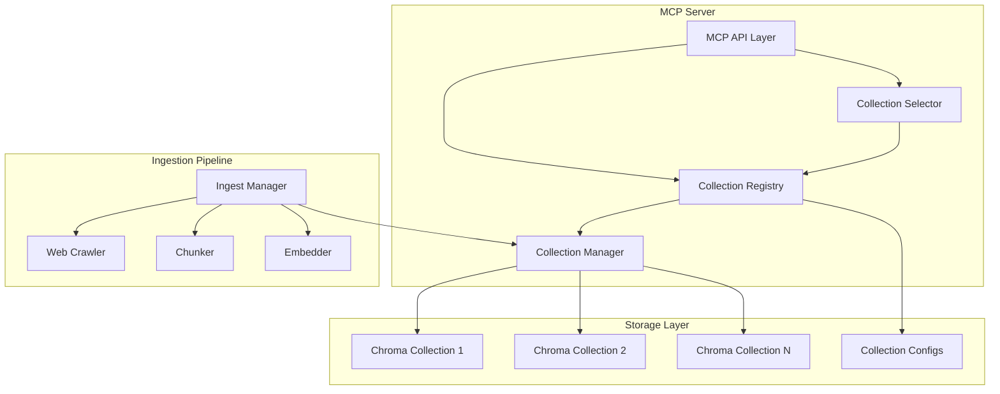

# Multi-Collection RAG System Architecture

> This system is designed exclusively for multi-collection operation. All configurations and operations are built around managing multiple document collections.

## Executive Summary

This document outlines the architectural design for the multi-collection RAG system, supporting multiple collections that each target different domains or documentation sources. The design emphasizes scalability and efficient collection selection.

## 1. Configuration Schema Design

### 1.1 Multi-Collection Configuration Format

The system uses a unified multi-collection configuration format.

#### Option A: Single Configuration File (`collections.yml`)

```yaml
# Multi-collection configuration
version: "2.0"  # Configuration version

# Global defaults (can be overridden per collection)
defaults:
  chunk_chars: 1200
  chunk_overlap: 200
  embedding_provider: sentence-transformers
  embedding_model: all-MiniLM-L6-v2
  chroma_persist_dir: data/chroma
  max_pages: 500
  concurrency: 8

# Collection definitions
collections:
  jj_docs:
    name: "JJ Documentation"
    description: "Jujutsu VCS documentation and guides"
    domain: "version-control"
    tags: ["vcs", "jj", "jujutsu", "git-alternative"]
    
    # Collection-specific crawling configuration
    sources:
      base_urls:
        - https://jj-vcs.github.io/jj/latest/
      allow_patterns:
        - ^https://jj-vcs\.github\.io/jj/latest/.*
      deny_patterns:
        - \.pdf$
        - \.zip$
        - \.(png|jpg|jpeg|gif|svg)$
    
    # Override defaults if needed
    chunk_chars: 1500
    chunk_overlap: 300
    
    # Collection metadata for selection
    metadata:
      language: en
      last_updated: "2024-01-15"
      version: "0.32.0"
      priority: 1  # Higher priority in case of ambiguous queries

  python_docs:
    name: "Python Documentation"
    description: "Official Python language documentation"
    domain: "programming-language"
    tags: ["python", "programming", "language", "stdlib"]
    
    sources:
      base_urls:
        - https://docs.python.org/3/
      allow_patterns:
        - ^https://docs\.python\.org/3/.*
      deny_patterns:
        - \.pdf$
        - /download/
    
    metadata:
      language: en
      version: "3.12"
      priority: 2

  langchain_docs:
    name: "LangChain Documentation"
    description: "LangChain framework documentation for LLM applications"
    domain: "ai-framework"
    tags: ["langchain", "llm", "ai", "rag", "agents", "chains"]
    
    sources:
      base_urls:
        - https://python.langchain.com/docs/
      allow_patterns:
        - ^https://python\.langchain\.com/docs/.*
      deny_patterns:
        - \.pdf$
    
    # Use different embedding model for this collection
    embedding_provider: openai
    embedding_model: text-embedding-3-small
    
    metadata:
      language: en
      priority: 1

# Collection registry metadata
registry:
  auto_discover: false  # If true, scan for collection configs in subdirectories
  collection_dir: ./collections  # Directory for individual collection configs
```

#### Option B: Multiple Configuration Files (Recommended for Scale)

Main registry file (`collections.yml`):
```yaml
version: "2.0"
defaults:
  chunk_chars: 1200
  chunk_overlap: 200
  embedding_provider: sentence-transformers
  embedding_model: all-MiniLM-L6-v2

registry:
  collections:
    - ./collections/jj_docs.yml
    - ./collections/python_docs.yml
    - ./collections/langchain_docs.yml
  auto_discover: true
  collection_dir: ./collections
```

Individual collection file (`collections/jj_docs.yml`):
```yaml
collection:
  id: jj_docs
  name: "JJ Documentation"
  description: "Jujutsu VCS documentation and guides"
  domain: "version-control"
  tags: ["vcs", "jj", "jujutsu", "git-alternative"]
  
sources:
  base_urls:
    - https://jj-vcs.github.io/jj/latest/
  allow_patterns:
    - ^https://jj-vcs\.github\.io/jj/latest/.*
  deny_patterns:
    - \.pdf$

config:
  chunk_chars: 1500
  chunk_overlap: 300
  
metadata:
  language: en
  version: "0.32.0"
  priority: 1
```


## 2. Collection Selection Algorithm

### 2.1 Query Analysis and Routing

The collection selector will use multiple strategies:

```python
class CollectionSelector:
    def __init__(self, registry: CollectionRegistry):
        self.registry = registry
        self.keyword_index = self._build_keyword_index()
        self.embedding_cache = {}
    
    def select_collection(
        self, 
        query: str, 
        strategy: str = "hybrid"
    ) -> CollectionMatch:
        """
        Select the most appropriate collection for a query.
        
        Strategies:
        - keyword: Fast keyword matching
        - semantic: Embedding similarity of query to collection descriptions
        - hybrid: Combination of keyword and semantic
        - explicit: User specifies collection in query
        """
        
        # Check for explicit collection reference
        explicit = self._check_explicit_reference(query)
        if explicit:
            return CollectionMatch(
                collection_id=explicit,
                confidence=1.0,
                reason="Explicit collection reference"
            )
        
        if strategy == "keyword":
            return self._keyword_match(query)
        elif strategy == "semantic":
            return self._semantic_match(query)
        else:  # hybrid
            return self._hybrid_match(query)
    
    def _keyword_match(self, query: str) -> CollectionMatch:
        """Match based on keywords, tags, and domain terms."""
        scores = {}
        query_tokens = set(query.lower().split())
        
        for coll_id, collection in self.registry.collections.items():
            score = 0
            # Check tags
            for tag in collection.tags:
                if tag.lower() in query_tokens:
                    score += 2.0
            
            # Check description
            desc_tokens = set(collection.description.lower().split())
            overlap = query_tokens & desc_tokens
            score += len(overlap) * 0.5
            
            # Check domain
            if collection.domain.lower() in query.lower():
                score += 1.5
            
            scores[coll_id] = score
        
        if not scores or max(scores.values()) == 0:
            return CollectionMatch(
                collection_id=None,
                confidence=0.0,
                reason="No keyword matches found"
            )
        
        best = max(scores, key=scores.get)
        confidence = min(scores[best] / 10.0, 1.0)
        
        return CollectionMatch(
            collection_id=best,
            confidence=confidence,
            reason=f"Keyword match (score: {scores[best]:.2f})"
        )
    
    def _semantic_match(self, query: str) -> CollectionMatch:
        """Match using embedding similarity."""
        query_embedding = self._get_embedding(query)
        
        similarities = {}
        for coll_id, collection in self.registry.collections.items():
            # Get or compute collection description embedding
            desc_key = f"{coll_id}_desc"
            if desc_key not in self.embedding_cache:
                desc = f"{collection.name} {collection.description} {' '.join(collection.tags)}"
                self.embedding_cache[desc_key] = self._get_embedding(desc)
            
            similarity = cosine_similarity(
                query_embedding, 
                self.embedding_cache[desc_key]
            )
            similarities[coll_id] = similarity
        
        if not similarities:
            return CollectionMatch(
                collection_id=None,
                confidence=0.0,
                reason="No collections available"
            )
        
        best = max(similarities, key=similarities.get)
        confidence = similarities[best]
        
        # Threshold for minimum confidence
        if confidence < 0.3:
            return CollectionMatch(
                collection_id=None,
                confidence=confidence,
                reason=f"Low semantic similarity ({confidence:.2f})"
            )
        
        return CollectionMatch(
            collection_id=best,
            confidence=confidence,
            reason=f"Semantic similarity ({confidence:.2f})"
        )
    
    def _hybrid_match(self, query: str) -> CollectionMatch:
        """Combine keyword and semantic matching."""
        keyword_match = self._keyword_match(query)
        semantic_match = self._semantic_match(query)
        
        # Weight combination
        if keyword_match.confidence > 0.7:
            # Strong keyword match takes precedence
            return keyword_match
        elif semantic_match.confidence > 0.6:
            # Good semantic match
            return semantic_match
        else:
            # Combine scores
            if keyword_match.collection_id == semantic_match.collection_id:
                # Agreement reinforces confidence
                combined_confidence = min(
                    (keyword_match.confidence + semantic_match.confidence) / 1.5,
                    1.0
                )
                return CollectionMatch(
                    collection_id=keyword_match.collection_id,
                    confidence=combined_confidence,
                    reason="Hybrid match (keyword + semantic agreement)"
                )
            else:
                # Disagreement - pick higher confidence
                if keyword_match.confidence > semantic_match.confidence:
                    return keyword_match
                else:
                    return semantic_match
```

### 2.2 Collection Match Response

```python
@dataclass
class CollectionMatch:
    collection_id: Optional[str]
    confidence: float
    reason: str
    alternatives: List[Tuple[str, float]] = field(default_factory=list)
    
    def to_dict(self):
        return {
            "collection_id": self.collection_id,
            "collection_name": self.get_collection_name(),
            "confidence": self.confidence,
            "reason": self.reason,
            "alternatives": [
                {"id": alt_id, "confidence": alt_conf}
                for alt_id, alt_conf in self.alternatives
            ]
        }
```

## 3. Enhanced MCP Tool API

### 3.1 New MCP Tools

```python
@server.tool()
def select_collection(query: str) -> Dict[str, Any]:
    """
    Analyze a query and select the most appropriate collection.
    Returns collection metadata and confidence score.
    """
    selector = get_collection_selector()
    match = selector.select_collection(query)
    
    if match.collection_id is None:
        return {
            "status": "no_match",
            "message": "No suitable collection found for this query",
            "reason": match.reason
        }
    
    collection = get_collection_registry().get(match.collection_id)
    return {
        "status": "success",
        "collection": {
            "id": match.collection_id,
            "name": collection.name,
            "description": collection.description,
            "confidence": match.confidence,
            "reason": match.reason
        },
        "alternatives": match.alternatives
    }

@server.tool()
def search_collection(
    query: str, 
    collection_id: Optional[str] = None,
    k: int = 5,
    auto_select: bool = True
) -> Dict[str, Any]:
    """
    Search within a specific collection or auto-select based on query.
    
    Args:
        query: Search query
        collection_id: Specific collection to search (optional)
        k: Number of results
        auto_select: If true and no collection specified, auto-select best collection
    """
    if collection_id is None and auto_select:
        # Auto-select collection
        selector = get_collection_selector()
        match = selector.select_collection(query)
        
        if match.collection_id is None:
            return {
                "status": "no_collection",
                "message": "No suitable collection found",
                "results": []
            }
        
        collection_id = match.collection_id
        selection_info = {
            "auto_selected": True,
            "collection_id": collection_id,
            "confidence": match.confidence,
            "reason": match.reason
        }
    else:
        selection_info = {
            "auto_selected": False,
            "collection_id": collection_id
        }
    
    # Perform search
    collection = get_collection_registry().get_collection(collection_id)
    if collection is None:
        return {
            "status": "error",
            "message": f"Collection '{collection_id}' not found",
            "results": []
        }
    
    results = collection.search(query, k=k)
    
    return {
        "status": "success",
        "selection_info": selection_info,
        "results": results
    }

@server.tool()
def list_collections() -> Dict[str, Any]:
    """
    List all available collections with their metadata.
    """
    registry = get_collection_registry()
    collections = []
    
    for coll_id, collection in registry.collections.items():
        collections.append({
            "id": coll_id,
            "name": collection.name,
            "description": collection.description,
            "domain": collection.domain,
            "tags": collection.tags,
            "document_count": collection.get_document_count(),
            "embedding_model": collection.embedding_model,
            "last_updated": collection.metadata.get("last_updated")
        })
    
    return {
        "collections": collections,
        "total": len(collections)
    }

@server.tool()
def get_collection_info(collection_id: str) -> Dict[str, Any]:
    """
    Get detailed information about a specific collection.
    """
    collection = get_collection_registry().get_collection(collection_id)
    
    if collection is None:
        return {
            "status": "error",
            "message": f"Collection '{collection_id}' not found"
        }
    
    # Sample documents
    sample = collection.peek(limit=5)
    
    return {
        "status": "success",
        "collection": {
            "id": collection_id,
            "name": collection.name,
            "description": collection.description,
            "domain": collection.domain,
            "tags": collection.tags,
            "config": {
                "chunk_chars": collection.chunk_chars,
                "chunk_overlap": collection.chunk_overlap,
                "embedding_provider": collection.embedding_provider,
                "embedding_model": collection.embedding_model
            },
            "statistics": {
                "document_count": collection.get_document_count(),
                "unique_urls": len(collection.get_unique_urls()),
                "last_updated": collection.metadata.get("last_updated")
            },
            "sample_documents": sample
        }
    }
```

### 3.2 Enhanced Existing Tools

The `search` tool automatically selects the best collection:

```python
@server.tool()
def search(query: str, k: int = 5) -> Dict[str, Any]:
    """
    Search across collections with automatic collection selection.
    """
    return search_collection(
        query=query,
        collection_id=None,
        k=k,
        auto_select=True
    )
```

## 4. System Architecture Components

### 4.1 Core Components



### 4.2 Component Descriptions

#### Collection Registry
```python
class CollectionRegistry:
    """
    Central registry for all collections.
    Handles discovery, loading, and caching of collection metadata.
    """
    def __init__(self, config_path: str):
        self.config_path = config_path
        self.collections: Dict[str, CollectionMetadata] = {}
        self._collection_instances: Dict[str, Collection] = {}
        self._load_registry()
    
    def _load_registry(self):
        """Load collection configurations from disk."""
        # Load main config
        # Discover additional collections if auto_discover
        # Validate and register each collection
    
    def get_collection(self, collection_id: str) -> Optional[Collection]:
        """Get or create a collection instance (lazy loading)."""
        if collection_id not in self.collections:
            return None
        
        if collection_id not in self._collection_instances:
            # Lazy load the collection
            metadata = self.collections[collection_id]
            self._collection_instances[collection_id] = Collection(metadata)
        
        return self._collection_instances[collection_id]
    
    def refresh(self):
        """Refresh registry from disk (hot reload)."""
        self._load_registry()
```

#### Collection Manager
```python
class Collection:
    """
    Represents an individual collection with its Chroma backend.
    """
    def __init__(self, metadata: CollectionMetadata):
        self.metadata = metadata
        self.client = get_client(metadata.persist_dir)
        self.emb_fn = build_embedding_function(
            metadata.embedding_provider,
            metadata.embedding_model
        )
        self.chroma_collection = get_or_create_collection(
            self.client,
            metadata.id,
            self.emb_fn
        )
    
    def search(self, query: str, k: int = 5) -> List[Dict]:
        """Search this collection."""
        if not self.has_data():
            return []
        
        results = self.chroma_collection.query(
            query_texts=[query],
            n_results=k
        )
        return self._format_results(results)
    
    def has_data(self) -> bool:
        """Check if collection has any documents."""
        try:
            r = self.chroma_collection.peek(limit=1)
            return len(r.get("ids", [])) > 0
        except Exception:
            return False
```

### 4.3 State Management

Multi-collection state management:

```python
# server.py
class MultiCollectionState:
    def __init__(self):
        config_path = os.environ.get("MULTI_COLLECTION_CONFIG_PATH", "ingest/multi-collection.yml")
        self.registry = CollectionRegistry(config_path=config_path)
        self.selector = CollectionSelector(self.registry)
    
    def get_collection(self, collection_id: str) -> Optional[Collection]:
        return self.registry.get_collection(collection_id)
    
    def select_collection(self, query: str) -> CollectionMatch:
        return self.selector.select_collection(query)

# Global state
_state: Optional[MultiCollectionState] = None

def get_state() -> MultiCollectionState:
    global _state
    if _state is None:
        _state = MultiCollectionState()
    return _state

def get_collection_registry() -> CollectionRegistry:
    return get_state().registry

def get_collection_selector() -> CollectionSelector:
    return get_state().selector
```

## 5. Environment Variables

The system uses the following environment variables for configuration:

| Variable | Default | Description |
|----------|---------|-------------|
| `MULTI_COLLECTION_CONFIG_PATH` | `ingest/multi-collection.yml` | Path to the multi-collection configuration file |
| `CHROMA_PERSIST_DIR` | `data/chroma` | Base directory for Chroma collections |
| `OPENAI_API_KEY` | - | Required for OpenAI embedding providers |
| `LOG_LEVEL` | `INFO` | Logging level (DEBUG, INFO, WARNING, ERROR) |
| `MAX_CONCURRENT_COLLECTIONS` | `10` | Maximum number of collections to load simultaneously |

Example usage:
```bash
export MULTI_COLLECTION_CONFIG_PATH="./config/collections.yml"
export CHROMA_PERSIST_DIR="./data/vector_store"
python -m rag_mcp.server
```

## 6. Implementation Strategy

### Phase 1: Foundation (Week 1)
1. Create configuration schema classes
2. Implement configuration loader
3. Build CollectionMetadata and CollectionRegistry classes
4. Set up multi-collection state management

### Phase 2: Collection Management (Week 2)
1. Implement Collection class with lazy loading
2. Create MultiCollectionState architecture
3. Update chroma_store.py to support multiple collections
4. Implement collection discovery mechanism

### Phase 3: Collection Selection (Week 3)
1. Implement CollectionSelector with keyword matching
2. Add semantic matching using embeddings
3. Implement hybrid selection strategy
4. Create collection match scoring system

### Phase 4: MCP API Enhancement (Week 4)
1. Add new MCP tools (select_collection, list_collections, etc.)
2. Enhance existing search tool with auto-selection
3. Add collection-specific resource URIs
4. Implement collection info endpoints

### Phase 5: Ingestion Updates (Week 5)
1. Update ingest.py to support multi-collection configs
2. Modify CLI to handle collection selection for ingestion
3. Add collection management commands (create, delete, update)
4. Implement incremental ingestion support

### Phase 6: Testing & Documentation (Week 6)
1. Create comprehensive test suite
2. Update documentation with examples
3. Performance testing and optimization
4. User guide creation

## 7. Performance Considerations

### 7.1 Lazy Loading
- Collections are loaded only when accessed
- Metadata is cached in memory
- Chroma connections are pooled

### 7.2 Embedding Caching
- Cache query embeddings for collection selection
- Cache collection description embeddings
- Implement TTL for cache invalidation

### 7.3 Scalability
- Support for 100+ collections
- Async loading of collection metadata
- Pagination for collection listing

## 8. Security Considerations

1. **Collection Isolation**: Each collection has separate permissions
2. **Query Logging**: Track which collections are accessed
3. **Rate Limiting**: Per-collection rate limits
4. **Access Control**: Future support for collection-level ACLs

## 9. Future Enhancements

1. **Cross-Collection Search**: Search across multiple collections simultaneously
2. **Collection Relationships**: Define relationships between collections
3. **Dynamic Collection Creation**: Create collections on-the-fly from URLs
4. **Collection Versioning**: Support multiple versions of the same documentation
5. **Federation**: Connect to remote collection registries
6. **Collection Templates**: Pre-defined templates for common documentation types

## Conclusion

This architecture provides a scalable solution for multi-collection RAG support. The design emphasizes:
- Clear separation of concerns
- Lazy loading for performance
- Flexible configuration options
- Smart collection selection
- Comprehensive MCP API

The phased implementation approach ensures each component can be tested thoroughly before proceeding to the next phase.
