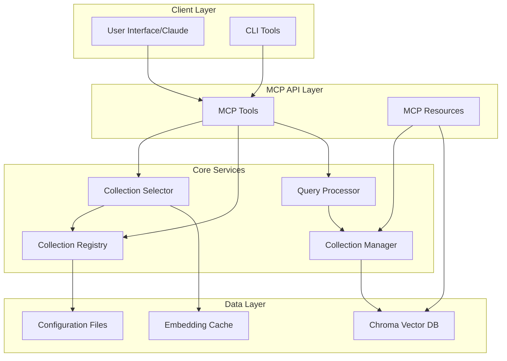
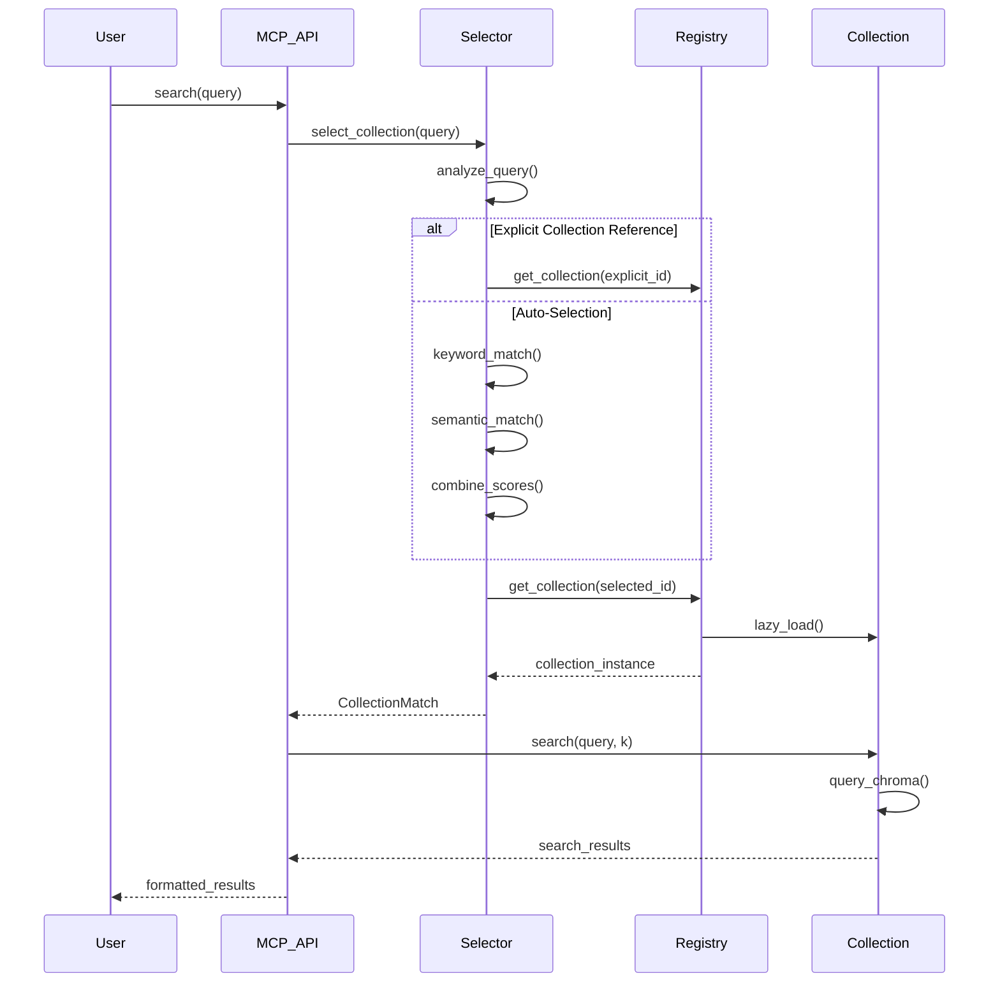
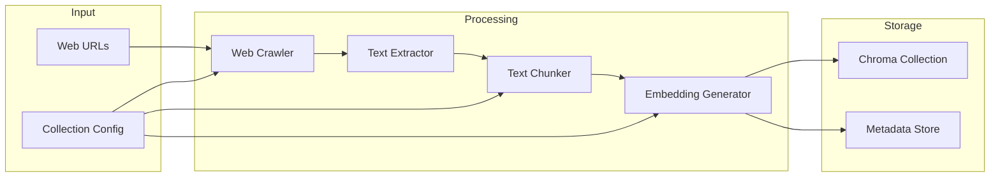
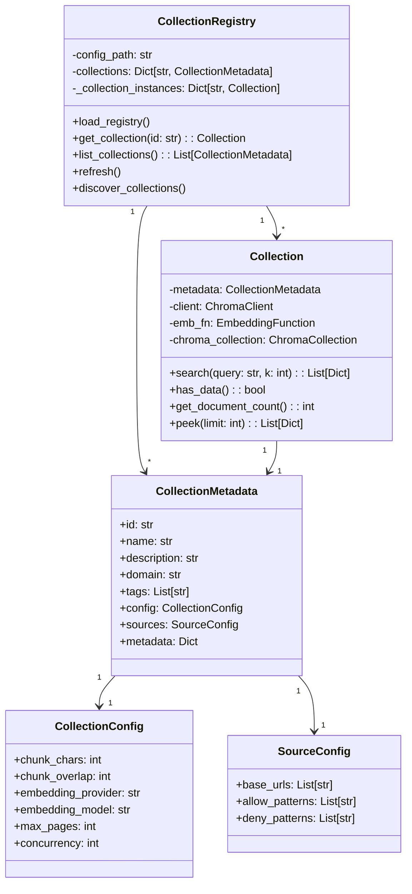
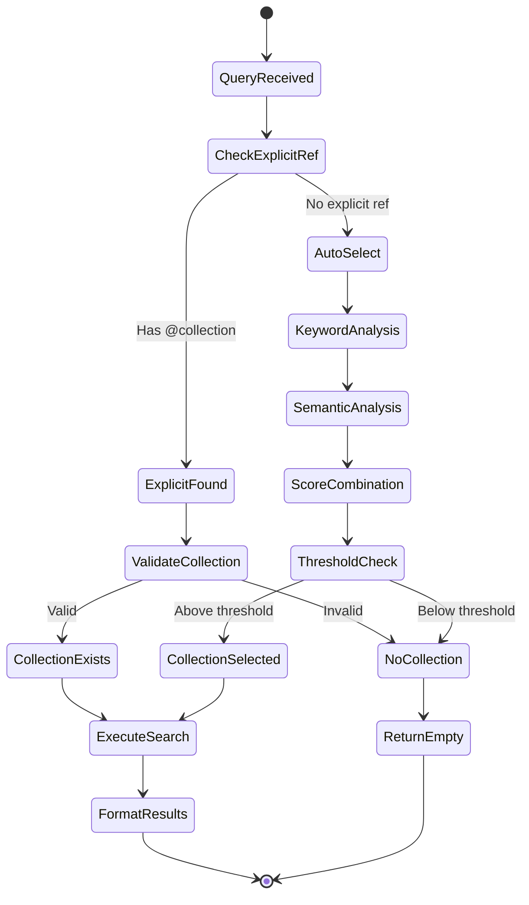
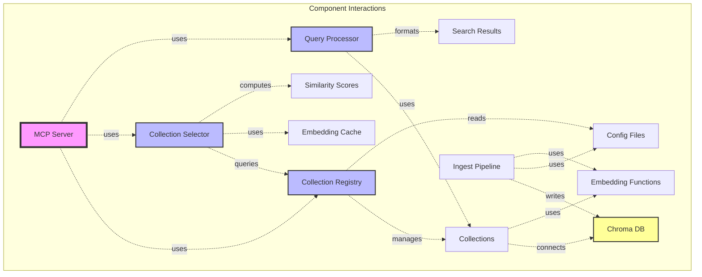
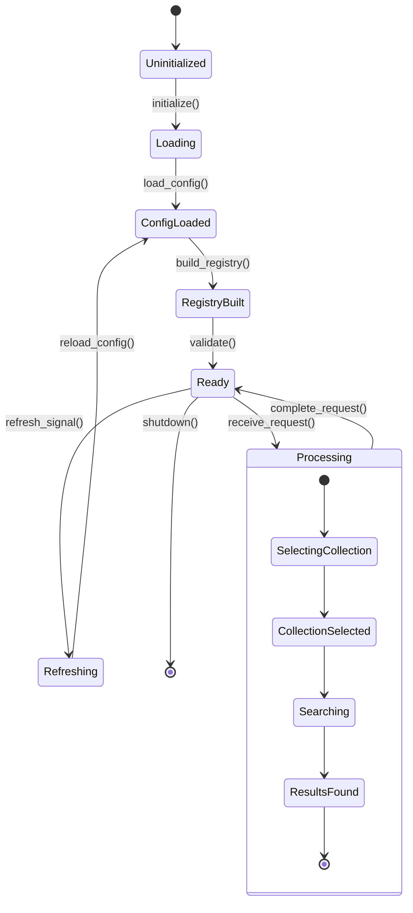
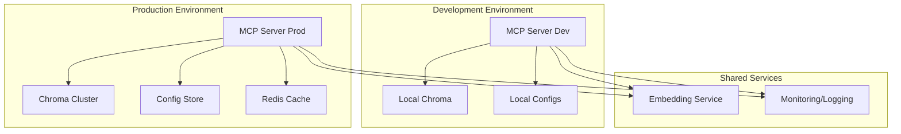
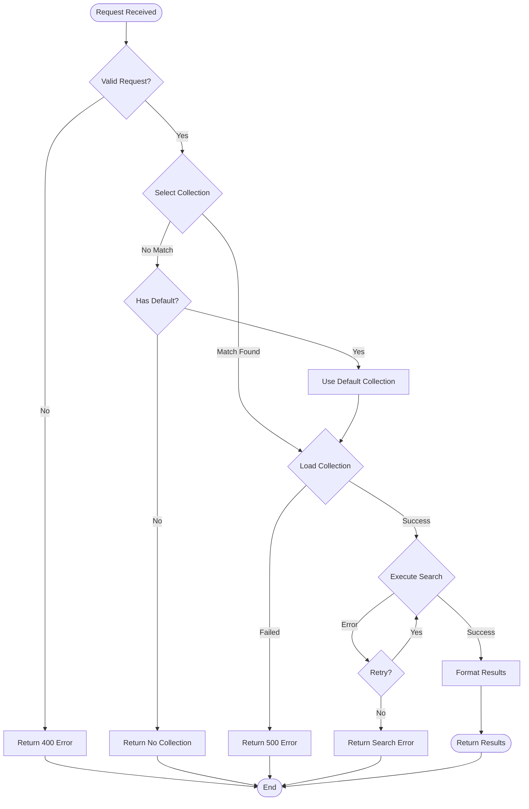

# Multi-Collection RAG System - Architectural Diagrams

## 1. System Overview



## 2. Collection Selection Flow



## 3. Data Ingestion Pipeline



## 4. Collection Registry Architecture



## 5. Query Processing Flow



## 6. Component Interaction Matrix



## 7. State Management



## 8. Deployment Architecture



## 9. Error Handling Flow



## 10. Caching Strategy

```mermaid
graph LR
    subgraph "Cache Layers"
        L1[Query Cache<br/>TTL: 5min]
        L2[Embedding Cache<br/>TTL: 1hr]
        L3[Collection Metadata<br/>TTL: 10min]
    end
    
    subgraph "Cache Operations"
        Check[Check Cache]
        Hit[Cache Hit]
        Miss[Cache Miss]
        Update[Update Cache]
    end
    
    Query --> Check
    Check --> Hit
    Check --> Miss
    Hit --> Return
    Miss --> Compute
    Compute --> Update
    Update --> Return
    
    L1 -.-> Check
    L2 -.-> Check
    L3 -.-> Check
